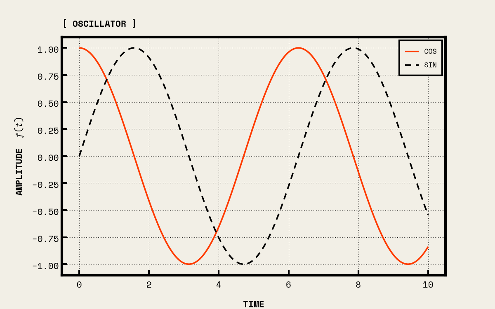

# plot_style

Library for plot style in matplotlib: the retro / digital-brutalist style of the figures of the blog. Monospace font (Space Mono, included), hard black box with square corners, inward ticks, dotted grid, one accent colour on a paper background.

| | |
|---|---|
| paper | `#f2efe6` |
| ink | `#000000` |
| accent | `#ff3b00` |

## Install

The package is not published: it is installed from the folder of the repository, with `pip`. The font (Space Mono) is inside the package, so nothing else has to be installed.

1. Get the repository and activate the environment where you make the figures (a conda environment, a virtualenv, or the base python):

   ```
   git clone https://github.com/pretidav/plot_style.git
   conda activate data_analysis          # for example
   ```

2. Install it from the folder, with the `pip` of that environment (`matplotlib >= 3.5` is installed with it if missing):

   ```
   pip install ./plot_style              # a copy of the package
   pip install -e ./plot_style           # or editable: changes to the files are used at once
   ```

3. Check it:

   ```
   python -c "import plot_style; print(plot_style.__version__)"
   python plot_style/examples/demo.py    # writes plot_style/examples/demo.png
   ```

Update after a `git pull` with the same command and `--upgrade` (an editable install needs nothing). Remove with `pip uninstall plot_style`.

The font comes from `plot_style/fonts/` (Space Mono, regular, bold, italic and bold italic, under the SIL Open Font License, copy of the license in the same folder). It is registered in matplotlib when `plot_style` is imported, which is also what happens when the style is used by name. If you also have Space Mono installed on the system, nothing changes.

## Use in matplotlib

Three equivalent ways to apply the style. Use one of them before creating the figures:

```python
import matplotlib.pyplot as plt
import plot_style

plot_style.use()                         # 1. every figure from now on

plt.style.use("plot_style.brutalist")    # 2. the standard matplotlib way, by name
                                         #    (the package is imported by matplotlib, so the font is registered)

with plot_style.context():               # 3. for the figures of a block only
    ...
```

A complete figure (the script is [examples/figure.py](examples/figure.py), and this is its output):



```python
import numpy as np
import matplotlib.pyplot as plt
import plot_style

plot_style.use()

x = np.linspace(0, 10, 200)
fig, ax = plt.subplots(figsize=(8, 5))
ax.plot(x, np.cos(x), color=plot_style.ACCENT, label="COS")   # the colour cycle is ink, accent, grey, sand
ax.plot(x, np.sin(x), color=plot_style.INK, ls=plot_style.DASHED, label="SIN")
ax.set_xlabel("TIME")
ax.set_ylabel(r"AMPLITUDE  $f(t)$")
ax.set_title("[ OSCILLATOR ]")

plot_style.style_axes(ax)                # square corners of the box (a style file cannot set them)
plot_style.legend(ax, "upper right")     # square, opaque legend with a hard frame
plot_style.savefig(fig, "figure.png")    # paper background, 150 dpi
```

`style_axes` and `legend` are optional: without them the figure has the font, the colours, the thick box, the inward ticks and the dotted grid, but the corners of the box are rounded off and the legend frame is thin. For several panels call `style_axes` on each axes (`style_axes(ax, grid=False)` for images and maps). Colormaps: `cmap=plot_style.CMAP_DIVERGING` (ink, paper, accent, centre it with `matplotlib.colors.TwoSlopeNorm`) or `plot_style.CMAP_SEQUENTIAL`, or by name `"brutalist_div"`, `"brutalist_seq"`.

The labels of the blog figures are in capitals, written by hand in the strings (`"ITERATION"`): the style makes them bold, it does not change their case.

## What is in it

- `brutalist.mplstyle`: colours, font (Space Mono, `fonts/`), box, ticks, grid, legend, titles (bold, left aligned), colour cycle (ink, accent, grey, sand), `savefig` background. Almost the whole style is here.
- `use()`, `context()`: apply it. `STYLE_PATH`: the path of the file.
- `style_axes(ax, grid=True)`: the rest of the box (square corners of the frame) and the grid. `style_legend(leg)`, `legend(ax, loc, **kw)`: the frame of the legend.
- `new_figure(figsize)`, `savefig(fig, path)`: a figure with the style and the paper background.
- `PAPER`, `INK`, `ACCENT`, `GREY`, `SAND`, `DASHED`, `DOTTED`: the colours and the two line styles used for reference lines.
- `CMAP_DIVERGING` (ink, paper, accent; use it with `TwoSlopeNorm`) and `CMAP_SEQUENTIAL` (paper, ink), also registered in matplotlib as `"brutalist_div"` and `"brutalist_seq"`.

`python examples/figure.py` makes the figure above and `python examples/demo.py` makes a second one with a legend, markers and a diverging colormap (`examples/demo.png`). `pip install -e "./plot_style[test]"` and `pytest plot_style/tests` run the checks.
